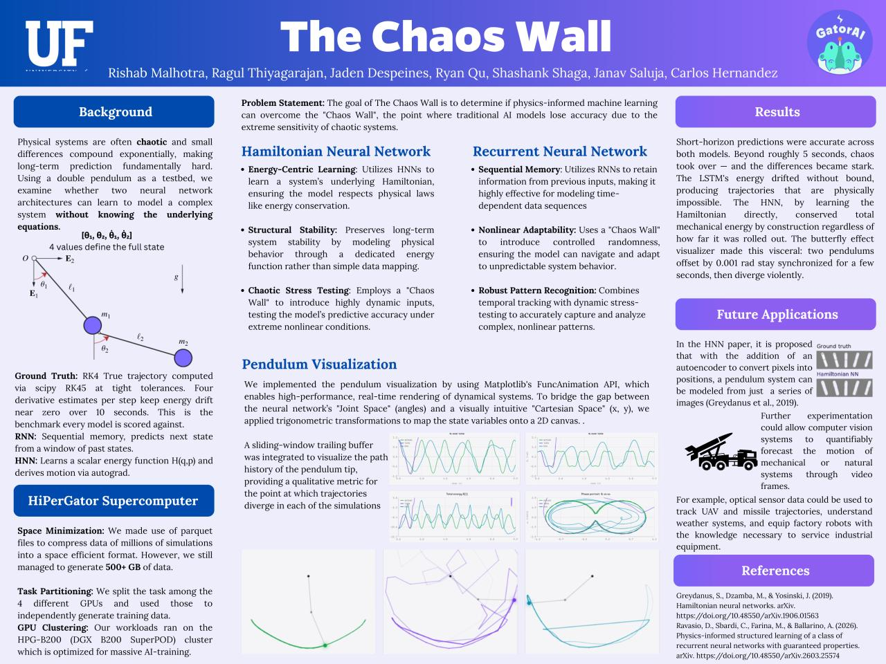

<!-- Header -->
<p align="center">
  
</p>

<p align="center">
  
</p>

<p align="center">
  <a href="https://www.linkedin.com/in/rishabmalhotra7580"></a>
  <a href="mailto:rishab.malhotra7580@gmail.com"></a>
  <a href="https://github.com/Rishab-Mal?tab=repositories"></a>
</p>

---

## About me

```cpp
struct Rishab {
    std::string school  = "Georgia Tech, B.S. Computer Science";
    std::string threads = "Intelligence + Systems & Architecture";
    std::vector<std::string> building = {
        "C++ servers benchmarked down to p99 latency",
        "physics-informed ML on a B200 SuperPOD",
        "real-time computer vision"
    };
    std::string focus   = "software, systems, AI infrastructure";
};
```

---

## Featured work

<table>
  <tr>
    <td width="50%" valign="top">
      <h3><a href="https://github.com/Rishab-Mal/kvstore">⚡ kvstore</a></h3>
      Multithreaded Redis-style key-value server with a sharded store, a crash-safe append-only log, and group-commit fsync.
      <br/><br/>
      <b>4x throughput</b> and <b>79% lower p99</b> from sharding, measured across 5 benchmark sessions.
      <br/><br/>
      
      
      
    </td>
    <td width="50%" valign="top">
      <h3><a href="https://github.com/Rishab-Mal/TheChaosWall">🌀 The Chaos Wall</a></h3>
      Can physics-informed ML beat chaos? Hamiltonian Neural Networks vs. LSTMs on a double pendulum.
      <br/><br/>
      <b>500+ GB</b> of simulation data generated on UF's <b>B200 SuperPOD</b>. The HNN conserved energy where the LSTM drifted.
      <br/><br/>
      
      
      
    </td>
  </tr>
  <tr>
    <td width="50%" valign="top">
      <h3><a href="https://github.com/Rishab-Mal/High-Performance-Event-Driven-Backtester-C-20-">📈 Event-Driven Backtester</a></h3>
      Low-latency engine for testing trading strategies on historical tick data, designed to avoid look-ahead bias.
      <br/><br/>
      
    </td>
    <td width="50%" valign="top">
      <h3><a href="https://github.com/Ryanqu27/SASEHacks-Visi">👁️ VISI</a></h3>
      🏆 <b>1st place, UF SASEHacks 2026</b> (Service Track). Real-time assistant for visually impaired users: gesture recognition, face detection, LLM scene narration, and speech.
      <br/><br/>
      
      
      
    </td>
  </tr>
</table>

<p align="center">
  <a href="https://github.com/Rishab-Mal/TheChaosWall"></a>
  <br/>
  <sub>The Chaos Wall research poster, Gator AI (2026)</sub>
</p>

---

## Tech stack

<p align="center">
  
  <br/>
  
</p>

---

<p align="center">
  
</p>
